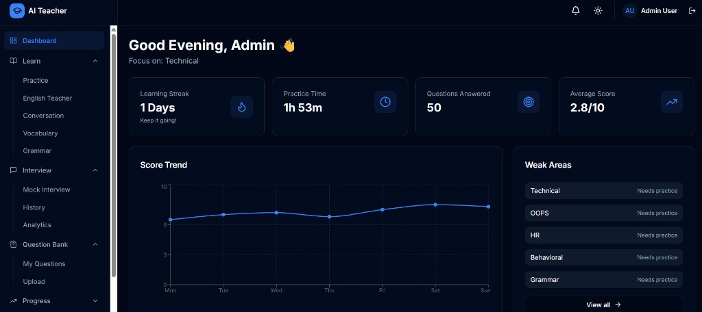
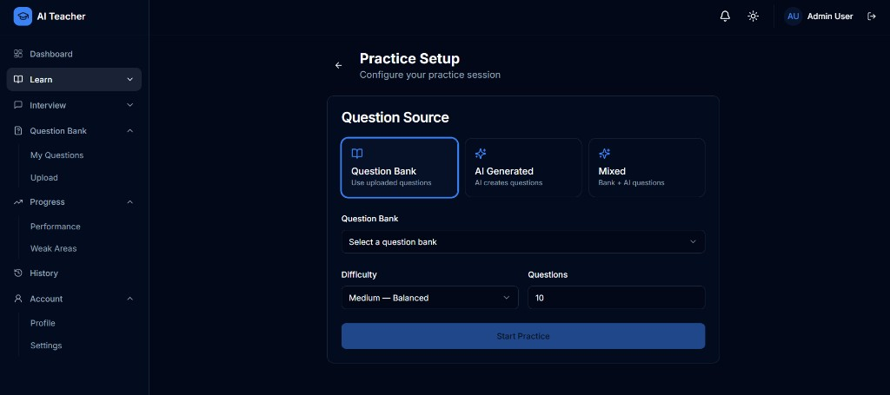

# AI Virtual Teacher

AI learning platform for **technical practice**, **English coaching** (including Hindi↔English translation & WH family), and **interview prep** — with scored feedback, question banks, and progress tracking.

## Screenshots

### Dashboard

Sidebar with collapsible menus, streak/stats cards, score trend, and weak areas.



### Practice Setup

Choose Question Bank / AI / Mixed, pick a bank, set difficulty and question count, then start.



## Features

- **Auth** — Register, login, logout, forgot/reset password
- **Dashboard** — Stats, trends, weak areas, quick actions
- **Practice sessions** — Bank / AI / mixed sources; end anytime; inline results; continue same category
- **English Teacher** — Grammar, vocabulary, conversation, sentence correction
- **Grammar topics** — Tenses, **Translation (50 Hindi→EN + 50 EN→Hindi, all 12 tenses)**, **WH Family**, Voice, Narration, Introduction, articles, conditionals, SVA
- **Interview Coach** — Setup, history, analytics
- **Question banks** — Public seeded banks + Excel/CSV upload by category
- **AI knowledge cache** — Reuses stored Q&A to reduce token usage
- **Weak areas** — Short, rated tips on low-scoring topics
- **Settings / Profile** — Theme, English level, AI preference
- **AI providers** — Gemini / OpenAI / Ollama via env (`AI_PROVIDER`)

## Tech stack

| Layer    | Stack |
|----------|--------|
| Frontend | React, TypeScript, Vite, Tailwind, shadcn/ui, TanStack Query, Zustand |
| Backend  | Node.js, Express, TypeScript, Prisma, MySQL, Redis |
| DevOps   | Docker, Docker Compose, Nginx |

## Quick start

### Prerequisites

- Node.js **20+**
- MySQL **8** and Redis **7** (or Docker)
- AI API key if using Gemini/OpenAI

### 1. Configure env

```bash
cp .env.example backend/.env
# Set DATABASE_URL, REDIS_URL, JWT secrets, GEMINI_API_KEY (or other provider)
```

### 2. Infrastructure (Docker)

```bash
docker-compose -f docker-compose.dev.yml up -d mysql redis
```

### 3. Backend

```bash
cd backend
npm install
npx prisma generate
npx prisma db push
npm run db:seed
npm run dev
```

API: **http://localhost:4000**

### 4. Frontend

```bash
cd frontend
npm install
npm run dev
```

App: **http://localhost:5174** (proxies `/api` → backend)

### Default admin (after seed)

| | |
|--|--|
| Email | `admin@virtualteacher.ai` |
| Password | `Admin@123456` |

## Seeded question banks

After `npm run db:seed`:

| Bank | Approx. size |
|------|----------------|
| Laravel, React, MySQL, OOPS, JavaScript | ~20 each |
| English — Tenses / Voice & Narration / Introduction | ~20 each |
| **English — Translation** | **100** (50↔50, all tenses) |
| **English — WH Family** | **~35** |
| Grammar, Vocabulary, Interview | ~20 each |

Questions are also upserted into the **AI knowledge cache** for reuse during practice.

## Project structure

```
backend/     Express API + Prisma + seed
frontend/    React SPA (port 5174)
docs/        Architecture + USER_MANUAL
docker/      Nginx / compose helpers
```

## Useful scripts

**Backend**

| Script | Purpose |
|--------|---------|
| `npm run dev` | API with hot reload |
| `npm run db:seed` | Seed admin, banks, knowledge cache |
| `npm run db:studio` | Prisma Studio |
| `npm run build` / `npm start` | Production build |

**Frontend**

| Script | Purpose |
|--------|---------|
| `npm run dev` | Vite dev server |
| `npm run build` | Production build |
| `npm run preview` | Preview build |

## Documentation

| Doc | Description |
|-----|-------------|
| **[User Manual](docs/USER_MANUAL.md)** | How learners use the app |
| [Architecture](docs/01-architecture.md) | System design |
| [Folder structure](docs/02-folder-structure.md) | Code layout |
| [Database ER](docs/03-database-er.md) | Data model |
| [API specification](docs/04-api-specification.md) | HTTP API |
| [AI providers](docs/05-ai-provider-architecture.md) | Gemini / OpenAI / Ollama |
| [Redis strategy](docs/06-redis-caching-strategy.md) | Caching |
| [Docker](docs/07-docker-architecture.md) | Containers |
| [UI screens](docs/08-ui-screens.md) | Screen map |
| [Roadmap](docs/09-development-roadmap.md) | Phased plan |

## Environment (main vars)

See `.env.example` / `backend/.env.example`:

- `DATABASE_URL` — MySQL connection  
- `REDIS_URL` — Redis  
- `JWT_SECRET` / `JWT_REFRESH_SECRET`  
- `AI_PROVIDER` — `gemini` \| `openai` \| `ollama`  
- `GEMINI_API_KEY` / `OPENAI_API_KEY`  
- `FRONTEND_URL` — CORS / cookies (e.g. `http://localhost:5174`)

## License

Private — All rights reserved.
