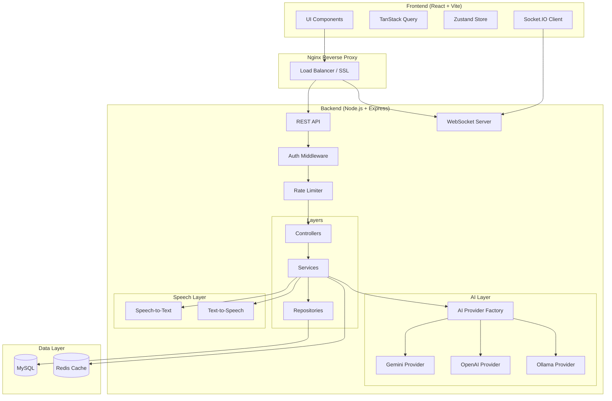
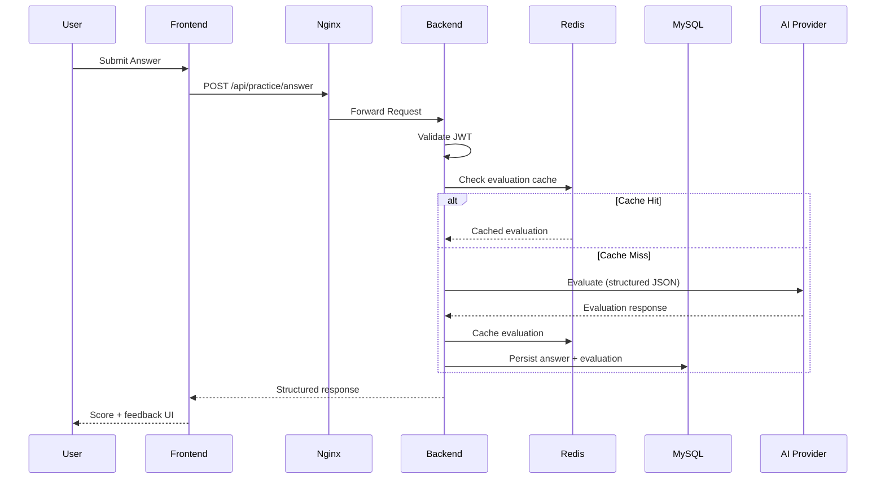

# AI Virtual Teacher — System Architecture

## High-Level Architecture

## Request Flow

## Layer Responsibilities

| Layer | Responsibility |
|-------|----------------|
| Controllers | HTTP handling, request/response mapping |
| Services | Business logic, orchestration |
| Repositories | Database access via Prisma |
| Validators | Zod schemas for input validation |
| Middleware | Auth, rate limit, error handling |
| AI Layer | Provider-agnostic AI operations |
| Cache Layer | Redis TTL-based caching |

## Security Boundaries

- API keys never exposed to frontend
- JWT access tokens (short-lived) + refresh tokens (httpOnly cookie)
- File uploads validated server-side, stored outside web root
- Rate limiting at IP, user, and AI request levels
