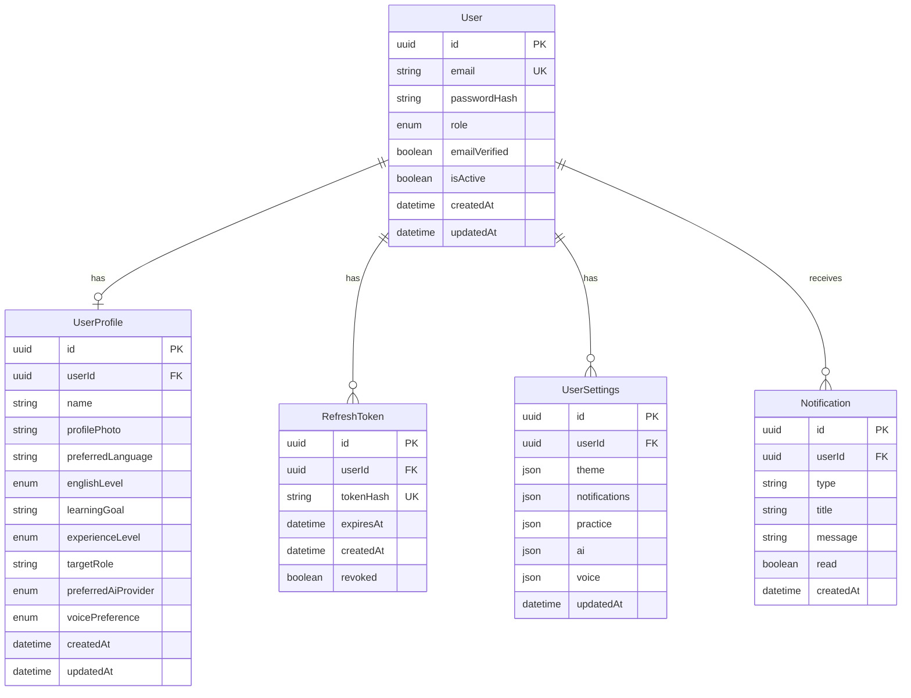
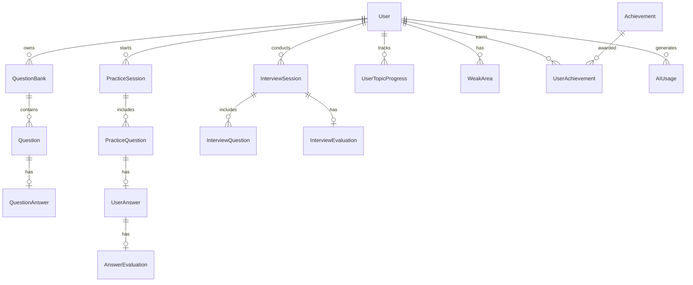

# Database ER Diagram

## Phase 1 Core Entities

## Full Schema (Future Phases)

## Indexes Strategy

| Table | Index | Purpose |
|-------|-------|---------|
| User | email | Login lookup |
| RefreshToken | tokenHash, userId | Token validation |
| PracticeSession | userId, status | Active session lookup |
| UserAnswer | sessionId | Session answers |
| AIUsage | userId, createdAt | Usage analytics |
| Question | bankId, topicId | Question listing |
