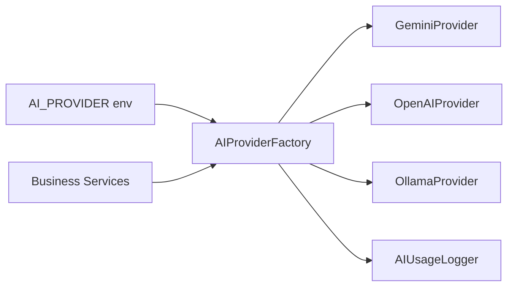

# AI Provider Architecture

## Interface Design

```typescript
interface AIProvider {
  readonly name: string;
  readonly model: string;

  generateAnswer(context: AnswerContext): Promise<string>;
  evaluateAnswer(context: EvaluationContext): Promise<EvaluationResult>;
  generateQuestion(context: QuestionContext): Promise<GeneratedQuestion>;
  generateHint(context: HintContext): Promise<string>;
  generateExplanation(context: ExplanationContext): Promise<string>;
  correctEnglish(context: EnglishContext): Promise<EnglishCorrection>;
  generateInterviewFeedback(context: InterviewContext): Promise<InterviewFeedback>;
  generateLearningPlan(context: LearningPlanContext): Promise<LearningPlan>;
  summarizeAnswer(context: SummarizeContext): Promise<string>;
}
```

## Provider Factory



## Provider Selection

```env
AI_PROVIDER=gemini   # gemini | openai | ollama
```

User-level override via `UserProfile.preferredAiProvider` when configured.

## Structured Response Validation

All AI responses validated with Zod before use:

```typescript
const EvaluationSchema = z.object({
  score: z.number().min(0).max(10),
  correctness: z.number().min(0).max(10),
  relevance: z.number().min(0).max(10),
  clarity: z.number().min(0).max(10),
  grammar: z.number().min(0).max(10).optional(),
  technicalAccuracy: z.number().min(0).max(10).optional(),
  communication: z.number().min(0).max(10).optional(),
  strengths: z.array(z.string()),
  improvements: z.array(z.string()),
  correctAnswer: z.string(),
  explanation: z.string(),
  shortModelAnswer: z.string(),
  confidence: z.number().min(0).max(1),
});
```

## Retry Strategy

1. Parse JSON from AI response
2. Validate with Zod schema
3. On failure: retry once with stricter prompt
4. On second failure: return safe fallback + log error

## Token Optimization

- Prompt templates versioned in `prompts/` directory
- Context window: current Q + answer + weak areas + last 3 interactions
- Redis cache for identical evaluations
- Configurable `MAX_OUTPUT_TOKENS` per request type

## Future Providers

Adding a new provider requires:
1. Implement `AIProvider` interface
2. Register in factory
3. Add env config
4. No changes to business logic
