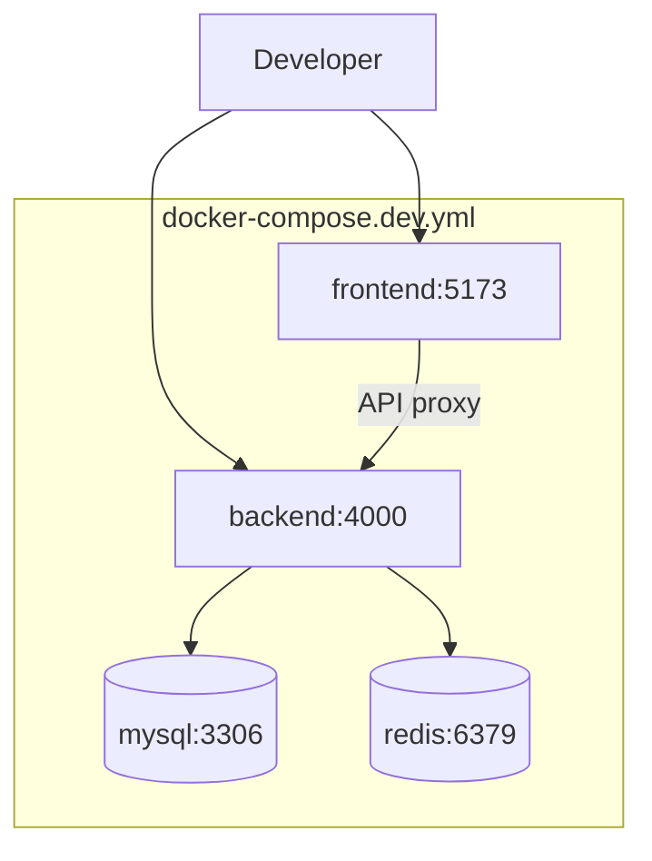
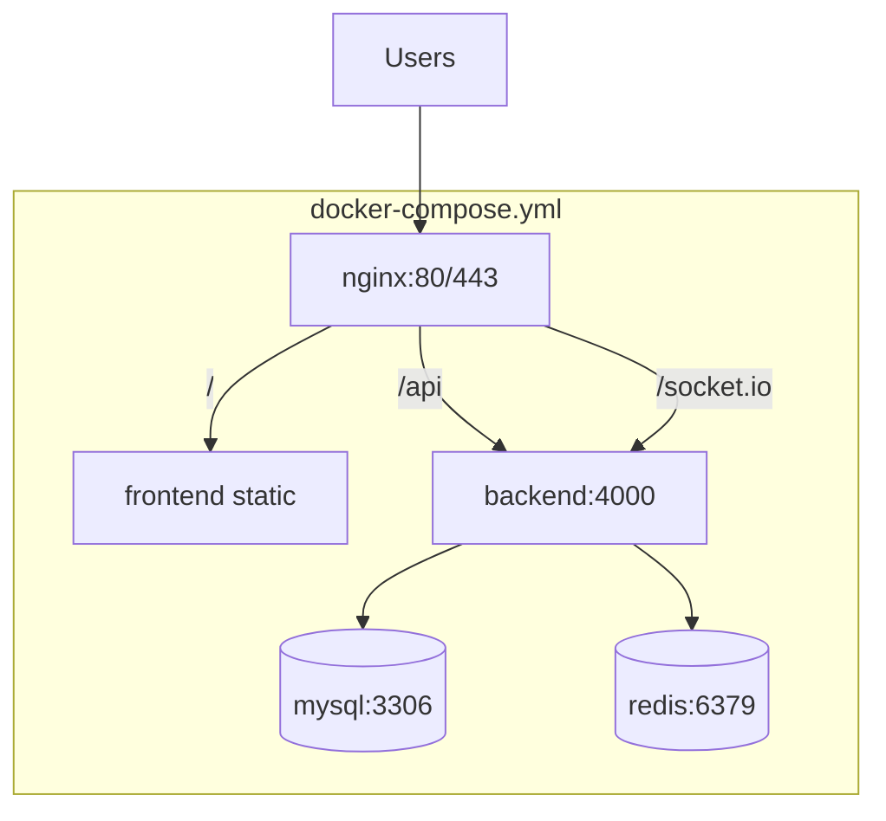

# Docker Architecture

## Development Stack



## Production Stack



## Services

| Service | Image | Ports | Volumes |
|---------|-------|-------|---------|
| frontend | node:20-alpine | 5173 (dev) | ./frontend:/app |
| backend | node:20-alpine | 4000 | ./backend:/app |
| mysql | mysql:8.0 | 3306 | mysql_data |
| redis | redis:7-alpine | 6379 | redis_data |
| nginx | nginx:alpine | 80, 443 | ./docker/nginx |

## Environment Separation

- `docker-compose.dev.yml` — hot reload, volume mounts, debug ports
- `docker-compose.yml` — production builds, no source mounts
- `.env.example` — template for all required variables

## Health Checks

```yaml
backend:
  healthcheck:
    test: ["CMD", "curl", "-f", "http://localhost:4000/api/v1/health"]
    interval: 30s
    timeout: 10s
    retries: 3

mysql:
  healthcheck:
    test: ["CMD", "mysqladmin", "ping", "-h", "localhost"]
```

## Network

All services on `avt-network` bridge network.
Backend connects to `mysql` and `redis` by service name.
